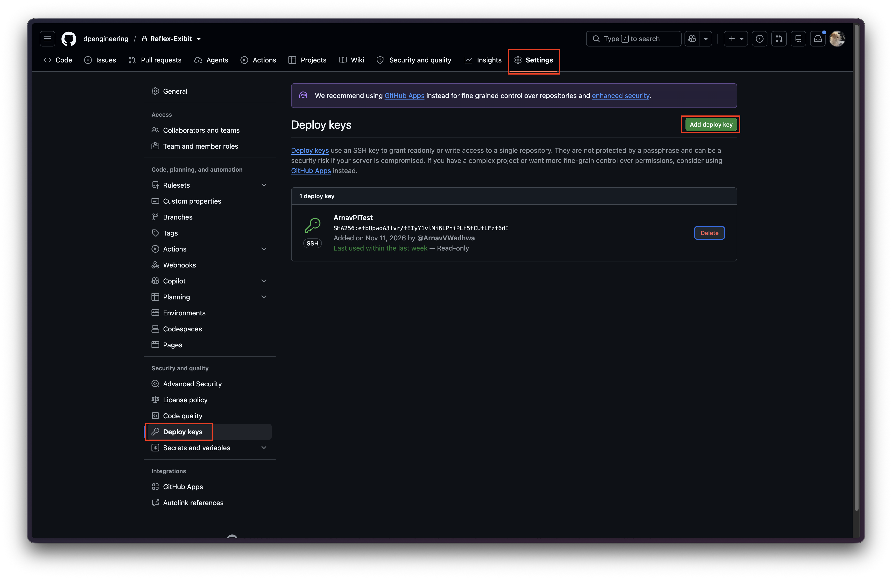
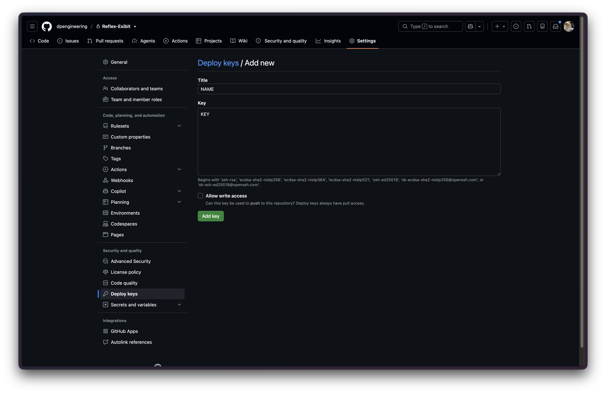

# GitHub Deploy Key

A deploy key is an SSH key that gives one machine access to one repo.
With a read-only deploy key, the Pi can git clone, git fetch, and git pull without anyone signing
in to GitHub on it, and it can't push.

Run every command on this page as the same user that will run git on the Pi. 
The key lives in that user's ~/.ssh folder, so another user (including root through sudo) won't find it.

## 1. Generate a key on the Pi

Check that the Pi doesn't already have a key:

```bash
ls ~/.ssh
```

If id_ed25519 is already listed, skip to step 2. Otherwise, generate one:

```bash
ssh-keygen -t ed25519 -C "raspberry-pi" -f ~/.ssh/id_ed25519
```

Press Enter twice when it asks for a passphrase to leave it blank. That lets git pull run without a prompt.

| Part                 | What it does                                                                                   |
|:---------------------|:-----------------------------------------------------------------------------------------------|
| -t ed25519           | Key type. Ed25519 is short, fast, and what GitHub recommends.                                  |
| -C "raspberry-pi"    | A label added to the end of the public key. It only helps you tell keys apart.                 |
| -f ~/.ssh/id_ed25519 | Where to save the key. SSH tries this default name automatically, so no extra setup is needed. |

## 2. Copy the public key

```bash
cat ~/.ssh/id_ed25519.pub
```

Copy the whole line it prints, starting with ssh-ed25519.
Only share the .pub file.
The file without .pub is the private key and should never leave the Pi.

## 3. Add the key to the repo on GitHub

1. Open the repo on GitHub and go to Settings > Deploy keys.
2. Click Add deploy key.
3. Give it a title like "raspberry pi" and paste the key.
4. Leave Allow write access unchecked so the key stays read-only.
5. Click Add key.





## 4. Test the connection

```bash
ssh -T git@github.com
```

The first time, SSH asks whether to trust github.com. 

GitHub lists its current fingerprints [here](https://docs.github.com/en/authentication/keeping-your-account-and-data-secure/githubs-ssh-key-fingerprints).

If it worked, you'll see:

```
Hi OWNER/REPO! You've successfully authenticated, but GitHub does not provide shell access.
```

## 5. Get the code

If the repo isn't on the Pi yet, clone it with the SSH URL:

```bash
git clone git@github.com:OWNER/REPO.git
```

If it's already cloned (for example over HTTPS), switch the remote from inside the repo folder:

```bash
git remote set-url origin git@github.com:OWNER/REPO.git
```

Then make sure pulling works:

```bash
git pull
```