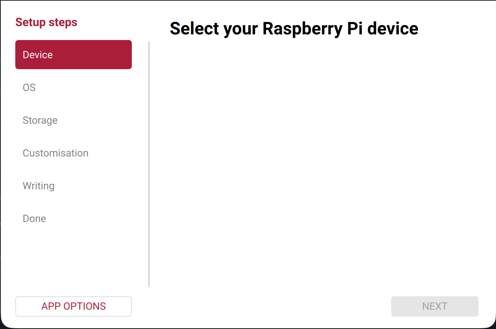
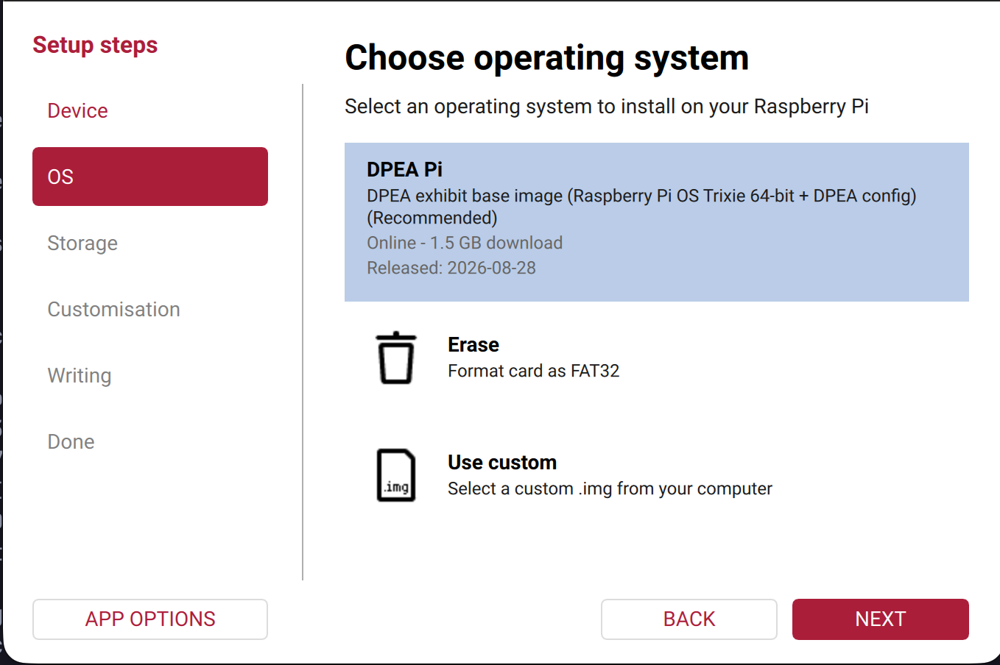
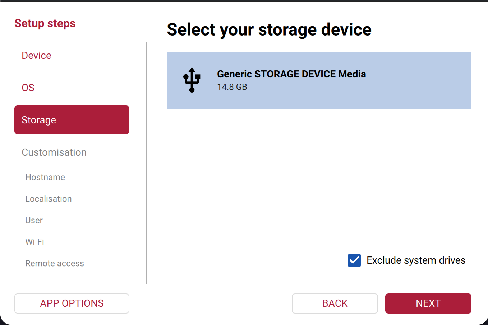
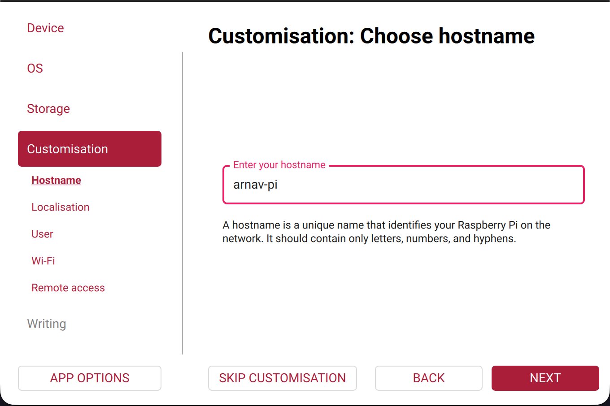
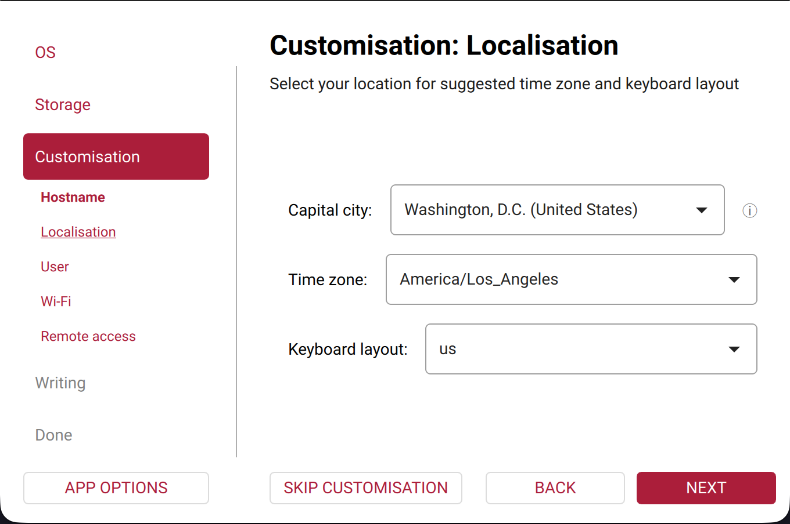
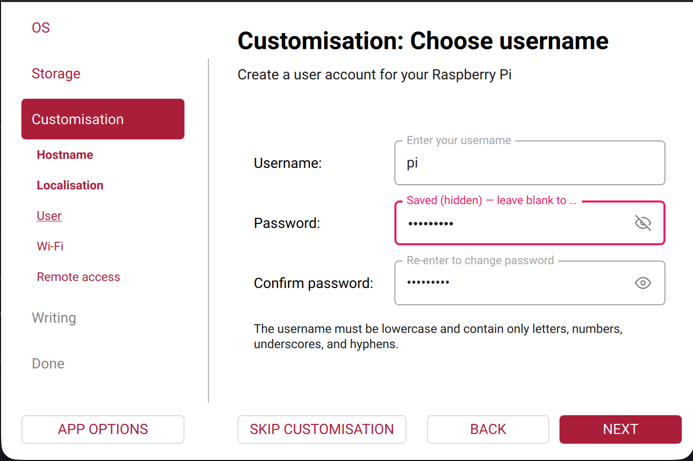
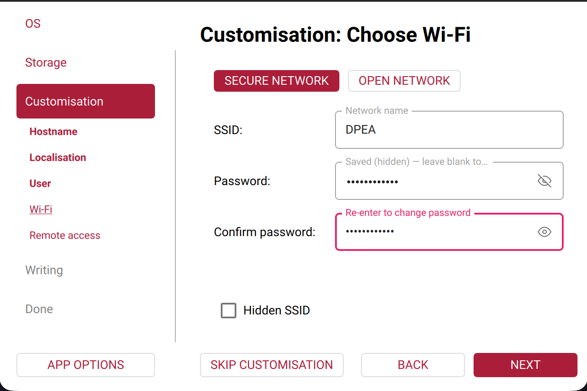
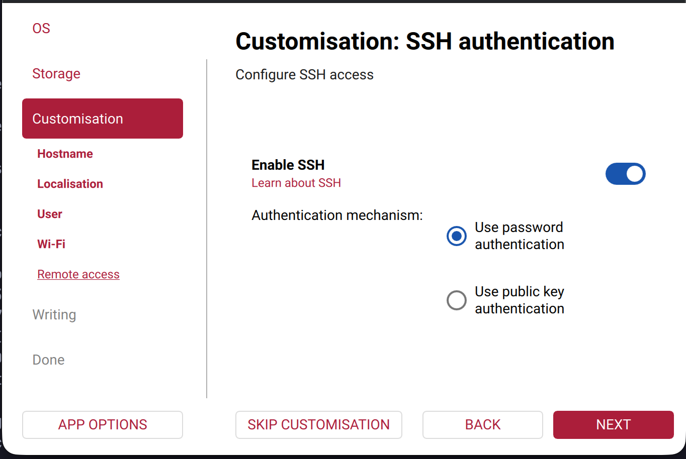
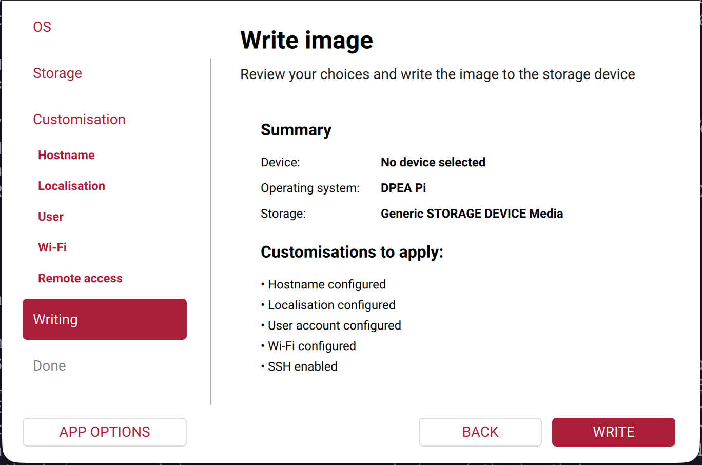

# Flash the SD Card

<iframe width="720" height="405" src="https://www.youtube.com/embed/SS9zlidy0O8" frameborder="0" allowfullscreen></iframe>

Every exhibit Pi runs the DPEA Raspberry Pi image. It's Raspberry Pi OS with I2C, UART, uv, and the exhibit networking already set up. This page writes it to a microSD card with Raspberry Pi Imager.

## What you need

- A microSD card, 16 GB or larger
- A way to plug the card into your computer, like an SD card reader
- Internet, since Imager downloads the image (about 1.6 GB)

{: .warning }
Flashing erases everything on the card.

## 1. Install Raspberry Pi Imager

Download Imager from [raspberrypi.com/software](https://www.raspberrypi.com/software/).

- **macOS:** open the .dmg and drag Raspberry Pi Imager into Applications.
- **Windows:** run the installer.
- **Linux:** download the AppImage. You'll make it executable in the next step.

## 2. Open Imager with the DPEA image list

Opening Imager from its icon only shows the standard Raspberry Pi images. Open it from a terminal with the command below instead, so DPEA Pi shows up in the OS list with its Customisation tabs.

In each command, replace IMAGER_PATH with where Imager is on your computer.

### macOS

IMAGER_PATH is the path to the Raspberry Pi Imager app. To copy it, right-click the app in Finder, hold Option, and choose Copy "Raspberry Pi Imager.app" as Pathname.

Open Terminal and run:

```bash
"IMAGER_PATH/Contents/MacOS/rpi-imager" --repo https://github.com/dpengineering/DPEA-RaspberryPiImage/releases/latest/download/os-list.json
```

Keep /Contents/MacOS/rpi-imager on the end. The .app is a folder, so running it directly fails with permission denied.

<!-- Screenshot: Terminal running the command -->

### Windows

IMAGER_PATH is rpi-imager.exe in Imager's install folder. To find it, right-click Raspberry Pi Imager in the Start menu, choose Open file location, then right-click the shortcut and choose Properties. The path is in the Target field. Copy it without the quotes.

Open Git Bash and run:

```bash
"IMAGER_PATH" --repo https://github.com/dpengineering/DPEA-RaspberryPiImage/releases/latest/download/os-list.json
```

<!-- Screenshot: Git Bash running the command -->

### Linux

IMAGER_PATH is the AppImage you downloaded. Run ls ~/Downloads/*.AppImage to find its exact name.

Make it executable once:

```bash
chmod +x IMAGER_PATH
```

Then run:

```bash
IMAGER_PATH --repo https://github.com/dpengineering/DPEA-RaspberryPiImage/releases/latest/download/os-list.json
```

If Imager says it needs elevated privileges, click Install Authorization and enter your password.

<!-- Screenshot: terminal running the command -->

## 3. Write the card

Plug in the SD card. Imager walks you through a few steps. Click Next after each one.

**Device:** the list is empty for the DPEA image, so there's nothing to pick. Click Next.



**OS:** choose DPEA Pi.



**Storage:** choose the SD card. Check that its size matches the card, and leave Exclude system drives checked so you can't erase your computer's drive.



### Customisation

**Hostname:** a name for this Pi using only letters, numbers, and hyphens, like newtons-cradle.



**Localisation:** set Time zone to America/Los_Angeles and Keyboard layout to us.



**User:** the username and password you'll log in with. The exhibit's services run as this user.



**Wi-Fi:** choose Secure network and enter the network the Pi will use, like DPEA. Ask an instructor for the password.



**Remote access:** turn on Enable SSH and keep Use password authentication, so you can work on the Pi from your laptop.



### Writing

Check the summary and click Write, then I understand, erase and write. Enter your computer's password if it asks. Writing and verifying take a few minutes. Wait until Imager says it's done before taking out the card.



## 4. Boot the Pi

Put the card in the Pi and power it on. The first boot takes a little longer while it applies your settings.

Next, give the Pi a [deploy key](deploying_to_rpi.html) so it can pull your repo.
